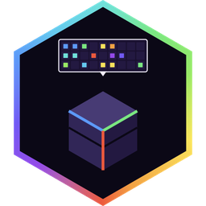

<div align="center">



# Alaydriem's Peek

[](https://github.com/alaydriem/peek/releases)
[](https://github.com/alaydriem/peek/actions/workflows/build.yml)
[](./LICENSE)

[](https://github.com/alaydriem/amml)

</div>

A shulker box preview for Minecraft Bedrock. While the pointer is over a shulker box in the player inventory or in a chest, a 9 x 3 grid of the box contents shows next to the pointer.

Client-side only. It reads inventory data the game already has and sends nothing to the server.

## Features

- 9 x 3 preview of a shulker box, next to the pointer
- Item pictures, enchantment glint, durability bars and stack counts, drawn by the game
- Works in the player inventory and in chests
- The vanilla contents lines of the hover text are left out while the preview is on

## Installation

Requires:

- the **AMML loader**, which loads the mod into the game. The loader also carries the recipes that find the game
  addresses the mod uses (in its `recipes/`). An older loader does not have them and the preview stays off. Update
  the loader first.
- [Alaydriem's Mod Manager](https://github.com/alaydriem/modmanager). Without the mod manager the preview stays off.

Download the zip from the [latest release](https://github.com/alaydriem/peek/releases/latest) and extract it.
It holds the folder `@alaydriem/peek`, with `alaydriem_peek.dll` and `amml.hcl`. Put that folder in the AMML mods
folder of the game, so that the files are in `mods/amml/@alaydriem/peek/`. Then enable the mod in the mod manager.

| Peek | Minecraft Bedrock | Mod Manager |
| --- | --- | --- |
| 0.1.0 | 1.26.60 | ABI 2.x |

## Configuration

There are no settings. Turn the preview on or off in the mod manager.

## Building

Requires Windows x64, [mise](https://mise.jdx.dev), rustup and [cargo-nextest](https://nexte.st). The `amml` and `modmanager-amml` repos must sit next to this one.

```powershell
mise trust
mise run preflight
mise run package
mise run test
```

`mise run package` writes `dist/@alaydriem/peek`.

## License

BSD 3-Clause. Copyright (c) 2026 Charles R. Portwood II. See [LICENSE](./LICENSE).
