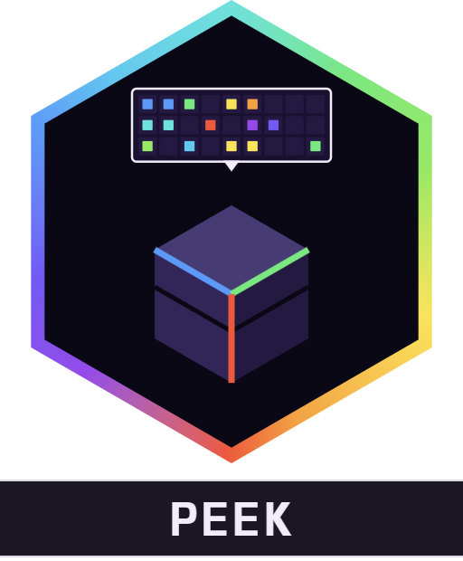

<div align="center">



# Alaydriem's Peek

[](https://github.com/alaydriem/amml-peek/releases)
[](https://github.com/alaydriem/amml-peek/actions/workflows/build.yml)
[](./LICENSE)

[](https://github.com/alaydriem/amml)

</div>

A shulker box preview for Minecraft Bedrock. While the pointer is over a shulker box in the player inventory or in a chest, a 9 x 3 grid of the box contents shows next to the pointer.

Client-side only. It reads inventory data the game already has and sends nothing to the server.

## Features

- 9 x 3 preview of a shulker box, next to the pointer
- Item pictures, enchantment glint, durability bars and stack counts, drawn by the game
- Works in the player inventory and in chests
- The vanilla contents lines of the hover text are left out while the preview is on

## Installation

Install it with the [AMML launcher](https://github.com/alaydriem/amml/releases/latest). The launcher also installs the AMML loader and Alaydriem's Mod Manager, which this mod needs.

## Configuration

There are no settings. Turn the preview on or off in the mod manager.

## Building

Requires Windows x64, [mise](https://mise.jdx.dev), rustup and [cargo-nextest](https://nexte.st). The AMML SDK and the mod manager crates are git dependencies on their public release tags (`Cargo.toml`); cargo fetches them. No sibling repos are needed.

```powershell
mise trust
mise run preflight
mise run package
mise run test
```

`mise run package` writes `dist/@alaydriem/peek`. `mise run install --instance <name>` runs `package`, then copies it into `%LOCALAPPDATA%\amml\instances\<name>\mods\amml\@alaydriem\peek\`. Close the game first.

## License

BSD 3-Clause. Copyright (c) 2026 Charles R. Portwood II. See [LICENSE](./LICENSE).
